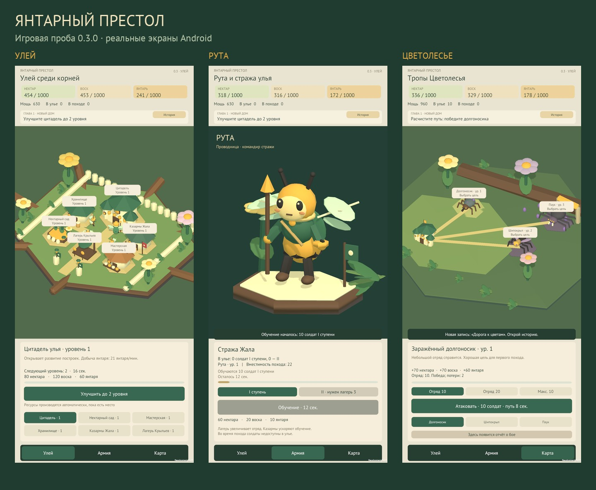

# PlagueGame

[Скачать последнюю APK для Android](https://github.com/Sanarakal/beewar/releases/latest/download/BeeWar-Android.apk) · [Все версии и изменения](https://github.com/Sanarakal/beewar/releases)

Откройте ссылку с телефона, скачайте APK и установите поверх предыдущей версии. Подключение по USB для этого не требуется. При первой установке Android может предложить разрешить установку из выбранного браузера.

Android-стратегия, вдохновлённая Last Asylum: Plague. Направление мира — пчелиные королевства. [«Янтарный престол»](style-and-story.md) описывает художественную основу и сюжет; первая игровая проба этого направления появилась в версии 0.3.0.

Основа игры — развитие личного замка и армии, участие в альянсе, захват городов на общей карте и борьба за престол игрового мира. Актуальный разбор и этапы разработки: [game-plan.md](game-plan.md).

## Открытие проекта

Дважды нажмите ярлык **PlagueGame** на рабочем столе или запустите `Open-Project.cmd` из этой папки. Откроется Unity 6.3 LTS.

Среда Unity уже установлена и проверена сборкой на подключённом Android-телефоне.

- `UnityProject/` — исходники и настройки Unity.
- `reference-analysis.md` — разбор игрового референса с источниками и ограничениями проверки.
- `game-plan.md` — актуальный план стратегии: замок, армия, общая карта, альянсы, города и король мира.
- `style-and-story.md` — предложение пчелиного мира: янтарные крепости, герои, сюжет и связь с войной альянсов.
- `research/` — материалы исследования.
- `setup/README.md` — установленные инструменты и технические проверки.

## Текущий прототип: пчелиное королевство

Улей с шестью постройками из воска, коры и листьев, пчёлы с подвижными крыльями, Рута на экране армии, три противника Цветолесья. Ресурсы — нектар, воск и янтарь. Улучшения, производство, обучение, походы, добыча и отчёт о бое работают с сохранением прогресса. Пролог и летопись связывают первые действия с историей Первоулия. Графика представляет первую художественную пробу.

Описание пчелиной версии: [bee-prototype-notes.md](bee-prototype-notes.md). Основа механик и проверки 0.2.0: [kingdom-prototype-notes.md](kingdom-prototype-notes.md). Настоящих игроков, альянсов и престола в этой версии ещё нет.

В Unity выберите **PlagueGame → Prototype → Open kingdom**, затем нажмите Play. Для сборки — **Build Android kingdom**. Из терминала: закройте редактор этого проекта и запустите `setup/Build-Android.ps1` в PowerShell.

Локальная APK: `UnityProject/Builds/Android/PlagueGame-Kingdom.apk`, версия 0.3.0. В Releases она называется `BeeWar-Android.apk`. Камера перемещается перетаскиванием и масштабируется двумя пальцами. Историю можно открыть повторно кнопкой «История».

## Обновления через GitHub

Исходники хранятся в `Sanarakal/beewar`; APK публикуется отдельным файлом в Releases. Ссылка «Скачать последнюю APK» всегда ведёт на последнюю опубликованную версию.

Для публикации: собрать и проверить APK, подготовить описание в `release-notes/vX.Y.Z.md`, сохранить исходники коммитом, создать тег `vX.Y.Z` на этом коммите и отправить ветку с тегом в GitHub. Затем выполнить `setup/Publish-Android.ps1 -Version X.Y.Z`. Скрипт загружает APK и SHA-256; требуется авторизованный GitHub CLI.

Предыдущая лечебница сохранена: **Open clinic**, **Build Android clinic**, либо `setup/Build-Android.ps1 -Clinic`. Её механики описаны в `prototype-notes.md`. Первоначальная техническая сцена доступна через меню **PlagueGame → Setup** и параметр `-EnvironmentCheck` скрипта сборки.

Конфигурация: только вертикальный экран, Android 8.0 или новее, ARM64, OpenGL ES 3. Горизонтальный режим отключён.

Blender и остальные инструменты доступны в меню **Пуск → PlagueGame**.
